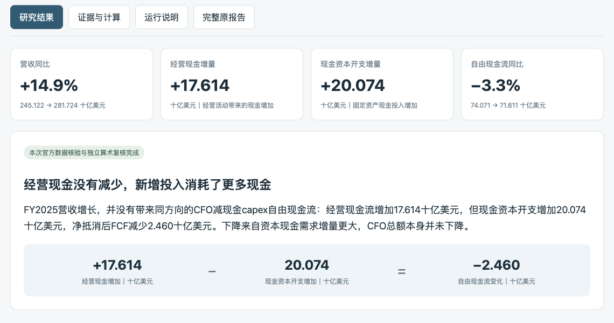

# 投研助手 · Touyan

从一个投研问题出发，**找到证据、看清分歧，形成有依据的判断**。

投研助手为 **Coding Agent** 提供一套可延续的研究方法：围绕问题规划取证、比较解释、调用计算工具，再由独立审查梳理关键结论。报告连到原文，后续追问沿着已有证据和判断继续推进。

仓库包含研究 Skill、Python 工具和兼容插件清单。你可以按所用客户端的插件或 Skill 机制加载；下文以 Claude Code 展示安装方式。

[](https://github.com/drewliu123/whymoved/actions/workflows/tests.yml)

## 先看一个真实例子

**问题：微软 FY2025 营收增长，为什么自由现金流反而下降？**

核对官方年报后，研究给出的解释是：经营活动多带来 **176.14 亿美元**现金，但现金资本开支多了 **200.74 亿美元**，所以按「经营现金流 − 现金资本开支」计算的自由现金流减少 **24.60 亿美元**。营收增长约 **14.9%**，该口径自由现金流下降约 **3.3%**。



- **[直接阅读研究报告](examples/msft-cashflow/research/work/report.md)**：先看判断和发现，再追溯计算与来源。
- **[查看完整案例](examples/msft-cashflow/README.md)**：研究输入、官方表格、独立算术脚本和运行记录。
- **[打开交互展示页](examples/msft-cashflow/index.html)**：下载后在浏览器查看研究结果、证据与计算、完整报告。

这次研究于 **2026-11-06** 完成，比较微软 **FY2024 与 FY2025** 的官方披露。报告把分散的财务指标连成一条现金流变化桥，并给出后续更新时值得继续核对的变量。

**第二个例子：利润增量到底来自哪个分部？** 用同一份官方分部表拆微软 FY2025：营业利润同比增加 **19,095** 百万美元，其中生产力与业务流程 **10,112**、智能云 **6,776**、个人计算 **2,207**——利润增量第一是生产力分部，不是云；云的收入增量更大但利润增量更低。这个例子演示分部驱动模型（含基期利润率）如何精确复现官方分部加总。

- **[阅读分部归因报告](examples/msft-segments/research/work/report.md)**
- **[查看完整案例与命令](examples/msft-segments/README.md)**

**第三个例子：利润增长有现金支撑吗？** 把损益表与现金流量表交叉核对：FY2025 经营现金流是净利润的 **1.34 倍**、资本开支是折旧摊销的 **1.89 倍**、增量利润率约 **52%**——利润有现金支撑，投入偏扩张；红旗筛查未触发，但资本开支强度是后续变量。这个例子演示 `report.quality` 如何嵌入完整报告，以及缺数据时如实留 null。

- **[阅读盈利质量报告](examples/msft-earnings-quality/research/work/report.md)**
- **[查看完整案例与命令](examples/msft-earnings-quality/README.md)**

**第四个例子：三年趋势里，质量有没有恶化？** 用 SEC XBRL 的 FY2023–FY2025 事实：现金转化三年均高于 1、应计为负、现金周期为负，增长质量总体稳定；但应收周转天数上升，是唯一压力点。这个例子演示多年趋势、应计/周转计算与报告内嵌折线图。

- **[阅读三年趋势报告](examples/msft-trend/research/work/report.md)**
- **[查看完整案例与命令](examples/msft-trend/README.md)**

**第五个例子：换一家公司还成立吗？** 苹果 FY2024 营业利润增长、净利润却下降——拆开税前与税项后，下降来自所得税跳升而不是经营恶化；ROIC 约 75.6%，但受回购与短期投资口径影响，不做跨公司比较。这个示例验证同一套工具在财年与结构都不同的公司上仍然成立。

- **[阅读苹果质量报告](examples/aapl-quality/research/work/report.md)**
- **[查看完整案例与命令](examples/aapl-quality/README.md)**

**第六个例子：FOMC 之后真的偏涨吗？** 用 FRED 的 S&P 500 日度收盘与美联储会议日历，对 2024 年 8 次 FOMC 做 −3/+3 观测点事件研究：后窗 6/8 为正、中位 +1.35%，但 7 月 31 日会后 3 个观测点跌约 6.1%，均值被压到接近零；绝对收益未去市场漂移，样本只有 8 次——不能当方向依据。

- **[阅读事件研究报告](examples/sp500-fomc-event/research/work/report.md)**
- **[查看完整案例与命令](examples/sp500-fomc-event/README.md)**

**第七个例子：AI 资本开支传导到设备商了吗？** 用四家公司的 SEC 10-K 事实逐节点核对：三家云厂商资本开支 FY2024→FY2025 增长约 60%，而应用材料收入只增长约 4.4%、经营现金流下降约 8.3%。总量传导没有闭合，瓶颈被定位到设备交付与客户结构。

- **[阅读传导报告](examples/ai-capex-transmission/research/work/report.md)**
- **[查看完整案例与命令](examples/ai-capex-transmission/README.md)**

**第八个例子：微软相对同行的市盈率折价是低估吗？** 用 Nasdaq 收盘价与四家公司最近财年的 SEC 盈利数据：微软 29.2x，同行中位 37.2x，折价约 21.5%；但 Alphabet 也只有 27.4x，且财年终点不同。折价事实成立，「低估」需要盈利预期与资本回报对齐后才能判断。

- **[阅读相对估值报告](examples/mega-cap-peers/research/work/report.md)**
- **[查看完整案例与命令](examples/mega-cap-peers/README.md)**

**第九个例子：现价隐含多少增长？** 用微软 FY2026 真实现金流与 2026-11-13 收盘价做反向 DCF：在 8% 折现、2.5% 终值、5 年假设下，现价隐含约 **31.2%** 的五年自由现金流增速；而同期 FCF 从 74,071 降到 66,987 百万美元。折现率改 7%/9% 时隐含增长约 25.4%/36.4%——假设本身决定结论。

- **[阅读反向 DCF 报告](examples/msft-reverse-dcf/research/work/report.md)**
- **[查看完整案例与命令](examples/msft-reverse-dcf/README.md)**

**第十个例子：一次复核如何被记住？** 两条真实归档（父研究 + 复核更新）冻结了 `thread` 沿革与 `digest` 摘要：父 → 子两轮、结论版本 1 个，判断未变但沿革保留。示例 home 是普通数据根，`doctor`、`digest`、`opportunities` 都按同一规则读取。

- **[查看跨轮记忆示例](examples/memory-workflow/README.md)**
- **[冻结的摘要输出](examples/memory-workflow/digest.md)**

想自己跑一遍？从 [跟做式教程](docs/tutorial.md) 开始：四类研究、每步命令与预期输出，全程离线。

想知道每项能力在哪里被验证？看 [能力索引](docs/capabilities.md)：能力 → 示例 / 测试 / 参考文档。

## 用它研究什么

- **解释变化**：公司为什么下跌？比较实际表现、背景和新增证据，区分不同解释。
- **梳理经营传导**：AI 用电增长如何进入设备公司的订单、利润和现金？找到值得深入核查的环节。
- **延续已有判断**：新披露改变了什么？保留旧研究，对比新增证据、判断变化和下一步观察。

每次研究围绕一个需要回答的问题展开。主研究 Agent 组织取证与分析，取证和审查 Agent 分工协作，工具展开计算与引用。你看到的是当前判断、重要发现和接下来该关注什么，完整底稿随报告保留。

### 能力地图

| 你会问的问题 | 用什么回答 | 参考 |
| --- | --- | --- |
| 这个价格贵不贵 | DCF、反向 DCF、可比公司倍数与分位、方法区间汇总 | [分析方法](skills/research/references/analysis-methods.md) |
| 增长是现金还是会计 | 盈利质量筛查：利润率趋势、现金转化、应计、周转、资本开支、红旗 | [盈利质量](skills/research/references/financial-quality.md) |
| 预期在上修还是下修 | 一致预期序列、修订方向与分歧；公司指引与分析师共识分开 | [预期取证](skills/research/references/expectations.md) |
| 下一个会改变判断的事件是哪天 | 催化日历（upcoming / overdue / undated） | [催化日历](skills/research/references/catalysts.md) |
| 之前判断过什么、改过几次 | 跨轮研究记忆、当时视角查询、判断沿革与多轮摘要 | [研究记忆](skills/research/references/research-memory.md) |
| 同类事件之后怎么走 | 参考类事件研究的窗口收益分布 | [事件研究](skills/research/references/event-study.md) |
| 这条产业链在哪一环断 | 行业传导图与瓶颈定位 | [行业传导](skills/research/references/transmission.md) |
| 报告里的数字能不能核 | 结构化数值事实、计算重算、模型输入与证据数值一致性 | [证据契约](skills/research/references/evidence.md) |
| 能不能先看一页 | 一页式 IC memo（只裁剪，不新增证据） | [报告模板](skills/research/references/memo-template.md) |

## 快速开始

### 1. 直接看研究效果

```bash
git clone https://github.com/drewliu123/whymoved.git
cd whymoved
```

在浏览器打开 [案例展示页](examples/msft-cashflow/index.html)，或直接在 GitHub 阅读 [Markdown 报告](examples/msft-cashflow/research/work/report.md)。

### 2. 安装到 Coding Agent（以 Claude Code 为例）

准备支持插件的 Claude Code、可用模型、网页与终端工具，以及 Python 3.9+。在实际克隆目录执行：

```bash
export TOUYAN_HOME="$PWD/.local/touyan-data"
mkdir -p "$TOUYAN_HOME"
claude plugin marketplace add .
claude plugin install touyan@touyan-local
claude
```

新会话中调用：

```text
/touyan:research 英伟达这个月为什么下跌？先比较行业表现，再判断公司特有因素
/touyan:research AI用电如何进入电力设备利润？找最值得验证的传导环节
/touyan:research update <run_id> 核对新增披露是否改变原判断
```

使用 Codex、DeepSeek Harness 或其他客户端？查看 **[安装与加载方式](docs/installation.md#其他-coding-agent-的加载方式)**。

`TOUYAN_HOME` 用于存放本机研究数据。数据目录、插件更新和可选接口的设置见[安装指南](docs/installation.md)。

## 研究怎样组织

| 层次 | 职责 |
| --- | --- |
| 主研究 Agent | 界定要作的判断，选择方法，规划取证，连接事实并形成结论 |
| 取证与审查 Agent | 根据证据缺口检索、比较不同解释，独立复核主判断与原始问题 |
| Workflow / 研究协议 | 连接研究计划、证据、主张、审查、报告和更新，保持过程可追溯 |
| Python 工具 | 检查引用、时间和分析契约，重算固定财务模型，渲染并保存研究档案 |
| 宿主客户端 | 提供模型、网页、文件、终端与子 Agent 等执行能力 |

固定模型覆盖经营利润桥、FCFF、DCF、反向 DCF 和可比公司相对估值，并提供单参数敏感性比较；两期以上报表可做盈利质量与红旗筛查。设计与计算口径见[架构说明](docs/architecture.md)和[分析方法](skills/research/references/analysis-methods.md)。

## 按研究需要连接数据

| 能力 | 如何启用 |
| --- | --- |
| 核心研究、证据校验、报告与归档 | Python 3.9+ 标准库，配合宿主的模型与网页工具 |
| SEC 原始披露 | 配置独立运行时，以精确文件和原始报表开展取证；见[设置步骤](docs/installation.md#可选sec-原始披露运行时) |
| Financial Datasets 适配器 | 对接财务报表与行情服务；账户授权与配置见[金融接口说明](skills/research/references/financial-data.md) |
| 社区材料 | 通过 Last30Days 补充讨论、观点与反例；见[来源说明](skills/research/references/sources.md) |

第三方 EdgarTools 源码以固定提交的子模块保留。需要阅读时，执行 `git submodule update --init --recursive`。

## 验证与开发

```bash
PYTHONDONTWRITEBYTECODE=1 python3 -m unittest discover -s tests
```

[CI](.github/workflows/tests.yml) 在 Python 3.9、3.11 和 3.12 下检查核心测试、真实示例文件哈希、独立算术、研究契约及报告渲染。重放示例与参与开发见 **[开发指南](docs/development.md)**。

## 继续探索

| 入口 | 内容 |
| --- | --- |
| [真实示例](examples/msft-cashflow/README.md) | 从问题到判断、官方出处、计算与运行记录 |
| [研究 Skill](skills/research/SKILL.md) / [Agent 定义](agents) / [脚本](scripts) | 研究方法、协作角色与验证工具 |
| [安装](docs/installation.md) / [架构](docs/architecture.md) / [开发与贡献](docs/development.md) | 运行、设计和维护说明 |
| [研究资料](research/README.md) | 实验、方法比较、原始研究资料与第三方源码 |
| [验证证据](evidence/README.md) | 取证、回归与各轮验收记录 |
| [研究档案](journal/README.md) | 历次研究报告、判断变化与工作记录 |
| [历史导出](delivery/README.md) / [数据说明](data/README.md) | 发布材料、运行数据与配置说明 |
| [版本记录](CHANGELOG.md) / [档案策略](docs/archive-policy.md) | 版本演进与完整历史的保留方式 |

研究过程和历史档案可从上表继续探索。项目代码采用 [MIT License](LICENSE)，第三方依赖与引用材料保留各自许可。
