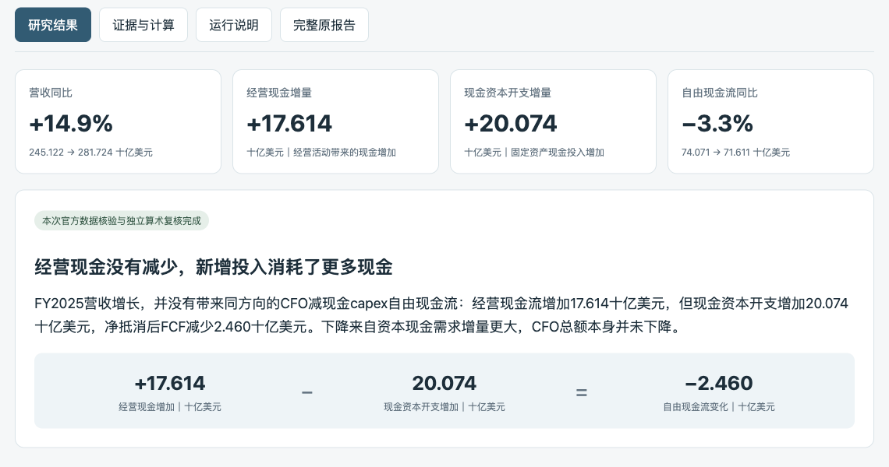

# 投研助手 · Touyan

把一个研究问题，推进到**有出处的判断、可复核的计算，以及下一项值得观察的变化**。

这是个人研究项目，以插件化方式组织主研究、取证与独立审查 Agent。当前插件入口为 **Claude Code**，核心验证与报告脚本使用 Python 标准库；研究结果可保存为 Markdown / HTML，并在用户追问时继续更新。

[](https://github.com/drewliu123/whymoved/actions/workflows/tests.yml)

## 先看一个真实例子

**问题：微软 FY2025 营收增长，为什么自由现金流反而下降？**

核对官方年报后，研究给出的解释是：经营活动多带来 **176.14 亿美元**现金，但现金资本开支多了 **200.74 亿美元**，所以按「经营现金流 − 现金资本开支」计算的自由现金流减少 **24.60 亿美元**。营收增长约 **14.9%**，该口径自由现金流下降约 **3.3%**。



- **[直接阅读研究报告](examples/msft-cashflow/research/work/report.md)**：判断、发现、计算、来源和后续复核条件。
- **[查看完整案例与复核方法](examples/msft-cashflow/README.md)**：冻结输入、官方表格、独立算术脚本和实际执行记录。
- **[离线交互展示页](examples/msft-cashflow/index.html)**：下载后用浏览器打开，可切换研究结果、证据、运行说明和完整原报告。GitHub 默认显示 HTML 源码，不将这个链接当作在线应用。

这是 2026-11-06 新运行的**历史财报案例**，比较 FY2024 与 FY2025，不代表最新经营或股价判断。取证与研究由宿主 Agent 执行，项目脚本负责校验、输出与归档；案例中透明算术由独立脚本复算，不强套口径不同的 FCFF 模型。

## 它适合解决什么问题

- **解释变化**：公司为什么下跌？先比较实际表现、背景与新增证据，而不只拼接新闻。
- **梳理经营传导**：AI 用电增长如何进入设备公司的订单、利润和现金？找出最值得核查的环节。
- **继续一项研究**：新披露是否改变原判断？保留旧结论，比较新增证据与判断变化。

与一次性问答相比，本项目把问题定义、证据引用、不同解释的检验、独立审查和版本记录组织成可复核的研究过程。报告先回答问题，再展示关键发现；完整证据与计算放在附录。

## 快速开始

### 1. 先看效果，无需配置数据接口

```bash
git clone https://github.com/drewliu123/whymoved.git
cd whymoved
```

打开 [案例展示页](examples/msft-cashflow/index.html)，或直接在 GitHub 阅读 [Markdown 报告](examples/msft-cashflow/research/work/report.md)。这一步不需要模型凭据、SEC 身份或金融数据 API。

### 2. 在 Claude Code 中启用插件

需要支持插件的 Claude Code、可用模型，以及网页检索、文件和终端工具；核心脚本需要 Python 3.9+。在上述**实际克隆目录**执行：

```bash
export TOUYAN_HOME="$PWD/.local/touyan-data"
mkdir -p "$TOUYAN_HOME"
claude plugin marketplace add .
claude plugin install touyan@touyan-local
claude
```

新会话中调用：

```text
/touyan:research 英伟达这个月为什么下跌？先比较行业表现，再判断公司特有因素
/touyan:research AI用电如何进入电力设备利润？找最值得验证的传导环节
/touyan:research update <run_id> 核对新增披露是否改变原判断
```

显式设置 `TOUYAN_HOME` 可将个人运行数据与源码、仓库示例分开。未设置时，旧脚本默认使用 `~/Desktop/投研助手`，保留这一行为用于兼容已有安装。完整设置、更新和可选接口见 **[安装指南](docs/installation.md)**。

> 当前提供 Claude Code 插件安装入口。其他具备相应工具的 Agent 可参考研究协议和脚本，但没有将其视为已提供其他客户端的插件适配。

## Agent、Workflow 和工具怎样分工

| 层次 | 职责 |
| --- | --- |
| 主研究 Agent | 界定用户要作的判断，选择方法，规划取证，连接事实并形成结论 |
| 取证与审查 Agent | 按证据缺口检索、检查不同解释，独立复核主判断与原始问题是否一致 |
| Workflow / 研究协议 | 规定计划、证据、主张、审查、报告和更新的连接要求，不替代经济判断 |
| Python 工具 | 检查引用、时间、数据结构及分析契约；重算受支持的固定模型，渲染并冻结研究档案 |
| 宿主客户端 | 提供模型、网页工具、终端和子 Agent 等执行能力；插件本身不包含模型权重 |

固定财务模型覆盖经营利润桥、自由现金流、DCF 和反向 DCF。自由公式只作透明记录；计算、原文含义和因果判断仍按各自口径复核。详细设计见 [架构说明](docs/architecture.md) 和 [分析方法](skills/research/references/analysis-methods.md)。

## 数据接口按需启用

| 能力 | 最低条件与当前边界 |
| --- | --- |
| 核心研究、证据校验、报告与归档 | Python 3.9+ 标准库；联网研究由宿主提供网页工具 |
| SEC 原始披露 | 可选：独立 Python 3.11+、EdgarTools 5.62.1、用户本机的 SEC 联系身份；见 [设置步骤](docs/installation.md#可选sec-原始披露运行时) |
| Financial Datasets | 可选：服务端授权与配额；公开无凭据探测曾返回 402，不将模拟响应测试当成真实授权取数成功 |
| 社区材料 | 可选：复用 Last30Days 引擎；其平台可用性与依赖单独配置，失败、无结果与部分成功分别记录 |

第三方 EdgarTools 源码以固定提交的子模块保留，便于追溯；普通离线示例与核心测试不要求下载它。如需查看第三方源码，再执行 `git submodule update --init --recursive`。

## 验证与开发

```bash
PYTHONDONTWRITEBYTECODE=1 python3 -m unittest discover -s tests
```

[CI](.github/workflows/tests.yml) 覆盖核心离线测试与真实示例的算术、计划、来源、主张、分析契约和渲染检查；不把这些检查视为所有外部接口均已联网验证。重放示例与贡献方式见 **[开发指南](docs/development.md)**。

本项目是研究辅助原型，不承诺预测收益或后台自动跟踪。严格校验能提高可复核性，不能自动证明来源语义、经济因果或投资优势。

## 仓库导航

| 入口 | 内容 |
| --- | --- |
| [真实示例](examples/msft-cashflow/README.md) | 从问题到判断、官方出处、计算与实际运行记录 |
| [研究 Skill](skills/research/SKILL.md) / [Agent 定义](agents) / [脚本](scripts) | 插件核心与验证工具 |
| [安装](docs/installation.md) / [架构](docs/architecture.md) / [开发与贡献](docs/development.md) | 运行、设计和维护说明 |
| [研究资料索引](research/README.md) | 实验、方法比较、原始研究资料与第三方源码 |
| [验证证据索引](evidence/README.md) | 真实取证、离线回归和各轮验收记录，分别标明范围 |
| [研究档案索引](journal/README.md) | 不可覆盖的研究报告、历史验证与冻结工作稿 |
| [历史导出](delivery/README.md) / [数据说明](data/README.md) | 保留的发布材料、运行数据和本机配置边界 |
| [版本记录](CHANGELOG.md) / [档案策略](docs/archive-policy.md) | 版本演进及完整历史的保留方式 |

完整研究过程和历史路径保留；运行缓存与本机配置不作为新安装的共享配置。第三方资料按其原许可使用；本项目代码采用 [MIT License](LICENSE)。
