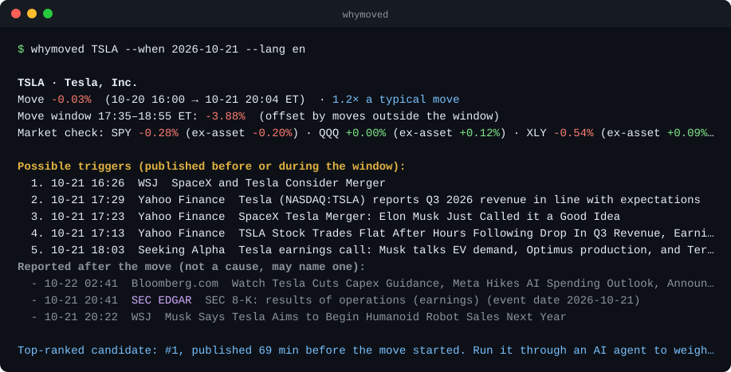

# whymoved

[English](README.md) | **简体中文**

[](https://github.com/drewliu123/whymoved/actions/workflows/ci.yml)


[](https://agentskills.io)
[](LICENSE)

**它为什么涨了？带出处的答案，找不到就说找不到。**

输入 `/why 特斯拉`，whymoved 会先找出这次涨跌**具体发生在哪个时间段**，再看大盘和板块有没有一起动，最后只把**异动之前**就已经公开的消息当作可能的原因。

支持美股和 ETF、港股、A 股（沪深）和加密货币。零配置、不需要任何 API key，只依赖 Python 标准库。可以作为 [Agent Skill](https://agentskills.io) 在 Claude Code、Codex、Cursor 等工具里使用，也可以直接在命令行运行。

<p align="center"></p>

## 和别的「为什么涨跌」工具有什么不一样

问 AI「这只股票今天为什么跌」，它通常会抓当天传播最广的那条新闻。但这条新闻经常是**跌完之后**才发的，内容只是在描述下跌，比如「特斯拉股价下挫……」。那是行情报道，不是原因。

whymoved 坚持一条别的工具会跳过的规则：

> **异动结束之后才发布的消息，不可能是这次异动的原因。**

为了执行这条规则，它分三步：

1. **定位异动窗口**：用分钟线找出能解释大部分涨跌的最短时间段，包括隔夜跳空（比如盘后发财报，会表现为第二天盘前的跳空）。
2. **对照大盘**：同一时间段里，指数和板块怎么走。美股看 SPY、QQQ 和所属板块 ETF，港股看恒生指数，A 股看沪深 300、创业板指或科创 50，加密货币看 BTC 或 ETH。如果基准本身就重仓这只股票（英伟达约占 SMH 的 20%），会先把它自己的贡献剔除，避免「自己解释自己」。
3. **按时间给证据分类**：新闻来自 Google News（港股和 A 股同时搜索中文媒体），美股还会查 **SEC 公告**及其精确的受理时间。异动前 24 小时内或异动中发布的，列为「可能的触发」；异动之后发布的，或者只是复述涨跌的，单独列为「涨跌之后的报道」。后者可能点名了原因，但本身永远不会被当作原因。

它还会判断这次涨跌值不值得解释：拿涨跌幅和这只资产**自己**平时的日波动比。同样是 2%，对特斯拉是日常波动，对可口可乐就是新闻。

## 示例：特斯拉，2026 年 10 月 21 日

特斯拉当天盘后发布三季报。那晚最显眼的标题是「Tesla Third-Quarter Earnings Top Views」（三季度盈利超预期）和「SpaceX and Tesla Consider Merger」（SpaceX 与特斯拉考虑合并）。引用任何一条都会答错：财报发布后股价基本没动，下跌是 30 多分钟后才开始的。

命令行输出见上图。在 AI Agent 里运行时，这份证据会连同推理规则一起交给模型，得到的回答大致如下：

```
TSLA 10 月 21 日盘后 −3.9%，几乎全部发生在 17:35–18:55 ET，正是三季度财报电话会进行期间。

不是财报本身：业绩在 17:00 ET 前已发布（Yahoo Finance 16:58「Earnings Top Views」），
之后股价持平（17:13「Trades Flat After Hours」）。
更可能的原因：电话会上的内容。Seeking Alpha 的电话会纪要（18:03）在异动窗口内；
异动之后的报道指向资本开支指引下调到 200 亿美元、Optimus 时间表放缓
（Yahoo Finance 19:56，Investing.com 22:18）。
大盘：SPY −0.3%；剔除特斯拉后，纳指 100 和可选消费板块基本持平，属于个股行情。
不是原因：SEC 8-K（20:41 ET）在下跌之后才提交，只能证实财报内容，不能证明时间先后。
置信度：中。时间点和电话会吻合；资本开支的细节来自异动之后的报道。
```

Agent 遵循的规则是：先看时间、先大盘后个股、宁可说「没有明确新闻」也不编原因、每次都给出置信度。具体见 [`SKILL.md`](skills/whymoved/SKILL.md)。

## 安装

**Claude Code**

```
/plugin marketplace add drewliu123/whymoved
/plugin install whymoved
```

**Codex、Cursor、Gemini CLI 等支持 Agent Skills 的工具**

```
npx skills add drewliu123/whymoved -g
```

**命令行**

```bash
pipx install git+https://github.com/drewliu123/whymoved   # 或 uv tool install git+https://...
whymoved NVDA
```

不想安装也可以：

```bash
git clone https://github.com/drewliu123/whymoved
python3 whymoved/skills/whymoved/scripts/why.py NVDA
```

## 用法

在 Agent 里直接问：「英伟达今天为什么跌」「腾讯为什么大跌」「茅台为什么涨了」「比特币昨天为什么暴涨」。

命令行：

```bash
whymoved NVDA                       # 最近一个交易日，中文简报
whymoved BTC --lang en              # 最近 24 小时，英文简报
whymoved TSLA --when 2026-10-21     # 指定日期
whymoved ETH --days 7               # 一整周
whymoved 腾讯                       # 港股：700、0700.HK、腾讯都可以
whymoved 600519                     # A 股：600519、300750.SZ、茅台都可以
whymoved 英伟达 --json              # 给 Agent 用的结构化证据，附原文链接
```

## 覆盖范围

| 资产 | 行情 | 证据 | 对照基准 |
|---|---|---|---|
| 美股和 ETF | Yahoo Finance 分钟线，含盘前盘后；当天数据可回退到 Nasdaq | Google News（英文）+ SEC 公告 | SPY、QQQ；约 80 只热门股票有板块 ETF |
| 港股 | Yahoo Finance 分钟线 | Google News（中英文） | 恒生指数；科技股加恒生科技 ETF |
| 沪深 A 股 | Yahoo Finance 分钟线 | Google News（中英文） | 沪深 300，以及创业板指或科创 50 |
| 加密货币 | Coinbase Exchange K 线 | Google News（英文） | BTC 或 ETH |

最近约 55 天是 5 分钟线，更早的是小时线。

## 局限

- 免费新闻搜索覆盖不到付费通讯社、社交媒体和很多交易所公告。「没有明确新闻」应理解为「公开标题里没找到」，不是「没有原因」。
- 聚合平台的时间戳可能比原始报道晚几分钟，whymoved 留了 10 分钟容差。SEC 公告经常比新闻稿晚几个小时，所以异动之后的公告能指向事件，但不能证明时间先后。
- 命令行的排序是启发式的，因果判断交给按 `SKILL.md` 推理的 Agent，或者你自己。
- SEC 要求自动化请求提供联系邮箱，可设置 `WHYMOVED_CONTACT=you@example.com` 使用你自己的。
- 不构成投资建议。

## 开发

```bash
python3 -m unittest discover -s tests   # 离线测试，不联网
ruff check .
```

最有价值的 issue 是「解释错了或漏了真正的原因」，请附上命令和输出（[模板](https://github.com/drewliu123/whymoved/issues/new?template=wrong_answer.yml)）。

## 路线图

- [x] 港股和 A 股
- [x] SEC 公告作为一手证据
- [ ] 财报日历（在财报发布前就知道它要来）
- [ ] 港交所披露易、巨潮资讯的公告
- [ ] 社交信号（X、Reddit、雪球）作为佐证
- [ ] 预测市场

## License

MIT
