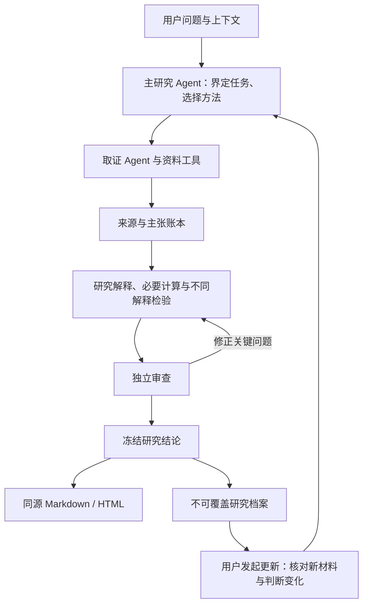

# 架构与研究边界

[返回首页](../README.md)

## 一次研究怎样完成

用户给出问题后，宿主中的主研究 Agent 先明确要帮助用户判断什么，再选择取证与分析方法。取证、社区线索和独立审查可由对应子 Agent 承担；模型负责材料选择与推理，Python 工具承担可以明确检查的结构、引用、时间和固定算术。

图示是职责与产物关系，不是后台自动运行承诺。宿主提供模型、网页、终端和子 Agent 执行能力；插件定义研究方法、工具与产物连接协议。

## Agent 与 Workflow

- **Agent 行为**：结合目标、现有材料和证据缺口选择方法、查询与补查；检索受预算和任务范围约束。
- **Workflow / 协议约束**：计划、来源、主张、审查、报告、归档和更新之间的要求，保证产物可以连接和复核。
- **确定性工具**：执行结构及引用检查、支持范围内的财务重算、报告渲染和带哈希的归档；不替代语义与经济判断。

流程可约束 Agent，Agent 也可在流程内部选择下一步动作；两者不是同义词或互斥方案。

## 主要代码入口

| 文件 | 职责 |
| --- | --- |
| [研究 Skill](../skills/research/SKILL.md) | 主研究方法、取证分工、审查和更新规则 |
| [Agent 定义](../agents) | 取证、社区线索、独立审查及可选预测角色 |
| [research_plan.py](../scripts/research_plan.py) | 研究问题、比较口径及检验计划校验 |
| [sources.py](../scripts/sources.py) | 来源契约、选择与去重审计 |
| [check_claims.py](../scripts/check_claims.py) | 主张引用、来源资格、时间及推断关系校验 |
| [analysis_contract.py](../scripts/analysis_contract.py) | 问题方法匹配、区分检验、模型与市场预期契约 |
| [analysis_models.py](../scripts/analysis_models.py) | 经营桥、FCFF、DCF和反向DCF固定模型 |
| [render_report.py](../scripts/render_report.py) | 从冻结报告生成同源Markdown和HTML |
| [research_run.py](../scripts/research_run.py) | 新建、更新、读取、比较与不可覆盖归档 |
| [sec_data.py](../scripts/sec_data.py) | 可选SEC披露取证入口，通过独立运行时使用EdgarTools |
| [financial_data.py](../scripts/financial_data.py) | 可选Financial Datasets适配器，授权与配额由服务方管理 |

## 数据和计算分别证明什么

`sources.json` 保存来源片段、原文定位、时间、原始出处家族和选择理由；`claims.json` 区分事实与推断，并引用来源或已有主张。`plan.json` 和 `report.analysis` 连接研究问题、候选解释与检验。通过校验，意味着这些契约满足程序要求，不等于来源内容或推理已自动正确。

固定财务模型会由代码重算。自由公式记录只检查结构、数值类型和引用，不执行任意表达式；需要独立计算和复核。示例中的 **CFO − 现金资本开支** 也不是固定模型的 **FCFF = 税后营业利润 + 折旧 − 资本开支 − 营运资本增量**，不能混用。

## 研究如何延续

每个归档保存本轮输入、报告与哈希。更新任务保留父报告，建立新的 run，再比较来源、主张、分析与判断变化。这能记录研究如何演进；它不等于后台监控、自动核查触发条件，或已完成长期持久研究状态系统。

## 可选接口与验证状态

默认核心工具使用 Python 3.9+ 标准库。SEC解析、Financial Datasets和社区引擎是独立的可选能力；接口失败、缺授权、部分成功与无结果分别记录。参见[安装指南](installation.md)、[SEC参考](../skills/research/references/sec-data.md)及[金融接口参考](../skills/research/references/financial-data.md)。

[微软真实示例](../examples/msft-cashflow/README.md)保留了真实取证、独立算术、审查和执行记录。其他研究材料和历史实验的性质见[研究索引](../research/README.md)、[证据索引](../evidence/README.md)与[档案索引](../journal/README.md)，不能将模拟响应或少量回归用例当作一般性研究准确率。
