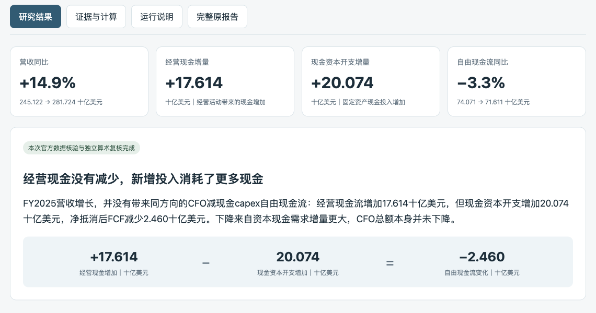

# 微软FY2025：营收增长，自由现金流为什么下降？

[返回项目首页](../../README.md) · [直接阅读完整研究报告](research/work/report.md) · [查看完整截图](preview.png)

这是2026-11-06按投研助手研究协议新运行的历史财报案例，比较FY2024和FY2025。它展示一次研究的输入、证据、计算、判断和复核过程，不代表截至今天的最新经营结论。

## 输入与结果

**输入：** 微软FY2025营收增长，为什么按经营现金流减现金资本开支定义的自由现金流反而下降？

**结论：** 经营活动多带来17.614十亿美元现金，但现金固定资产投入多了20.074十亿美元，净抵消后自由现金流减少2.460十亿美元。收入增长14.9%，该口径自由现金流下降3.3%。经营现金流总额没有下降。



报告还区分了「投资活动净流出」和「现金资本开支」：前者减少不意味着后者下降，收购及其他投资项目会影响投资现金流净额。后续更新应取下一完整财年的同口径数据，重新比较经营现金与资本现金需求。

## 怎样查看

- **直接读结果：** [Markdown完整报告](research/work/report.md)，GitHub可直接渲染。
- **交互查看：** 下载仓库后在本地浏览器打开 [index.html](index.html)，切换研究结果、证据与计算、运行说明、完整原报告。GitHub中的HTML文件页显示源码，不是在线演示站点。
- **追溯事实：** [微软官方2025年报](https://www.microsoft.com/investor/reports/ar25/index.html)、[原始财务表格](research/evidence/official-tables.json)、[引用片段](research/evidence/official-excerpts.txt)与[获取记录](research/evidence/download.json)。

## 实际运行了什么

取证与研究由本次宿主会话Agent执行：打开官方年报，核对FY25/FY24表头和现金支出符号，形成不同解释及研究判断，再由独立审查核对。原项目实际运行计划、来源、主张、分析契约检查，生成同源Markdown/HTML，并归档为不可覆盖快照。

- 原归档run_id：`R20261106T143422Z-a56d1e862f71`。
- [真实执行记录](execution-portable.json)：本机目录已归一化，保留失败与修正记录，不声称首次运行全部成功。
- [独立复核摘要](review-summary.json)：核心数字核验通过，按反馈修正历史案例的时点表达，最终文字由主研究者核对。

展示页是本次研究输出的便携呈现，不表示插件已经拥有独立客户端或无人值守服务。示例不包含简历、个人联系方式、公司内部数据或用户增长数据。

## 从冻结数据复核

从仓库根目录运行，核心检查仅需Python3.9+标准库，不需要SEC身份或金融API：

```bash
PYTHONDONTWRITEBYTECODE=1 python3 examples/msft-cashflow/research/recompute_bridge.py
PYTHONDONTWRITEBYTECODE=1 python3 examples/msft-cashflow/research/work/arithmetic.py
python3 scripts/research_plan.py examples/msft-cashflow/research/work/plan.json
python3 scripts/sources.py validate examples/msft-cashflow/research/work/sources.json
python3 scripts/check_claims.py examples/msft-cashflow/research/work/claims.json --sources examples/msft-cashflow/research/work/sources.json --json
python3 scripts/analysis_contract.py check --plan examples/msft-cashflow/research/work/plan.json --report examples/msft-cashflow/research/work/report.json --claims examples/msft-cashflow/research/work/claims.json --sources examples/msft-cashflow/research/work/sources.json
```

算术脚本从官方表格快照重新提取数字并断言现金流变化桥。其输出可能重写本例的派生JSON文件；它们不是新的联网取数结果。重新渲染请选择新目录：

```bash
python3 scripts/render_report.py examples/msft-cashflow/research/work/report.json --claims examples/msft-cashflow/research/work/claims.json --sources examples/msft-cashflow/research/work/sources.json --out-dir .local/msft-replay
```

两份算术脚本和[留存的计算证明](research/evidence/calculation-proof.json)用来复核实际算术；项目对透明公式记录只检查结构、引用和数据类型，不执行任意公式。本题的CFO减现金PPE不是DCF所需FCFF，未强套[固定模型](../../scripts/analysis_models.py)。全部现金PPE也不能视作AI专属投入或用于直接推算AI ROI。

[SHA256清单](SHA256.json)覆盖本目录的便携文件，`SHA256.json`自身不参与自校验。清单针对当前示例，不冒充原始归档manifest；原始HTML快照哈希在获取记录中，原文快照未全量复制进本目录。

更多运行与依赖设置见[安装指南](../../docs/installation.md)，检查范围见[开发指南](../../docs/development.md)。
