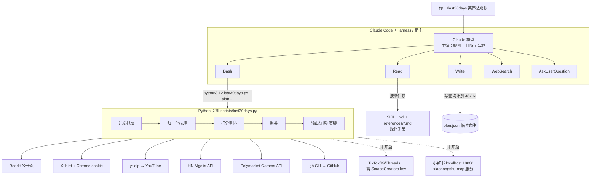
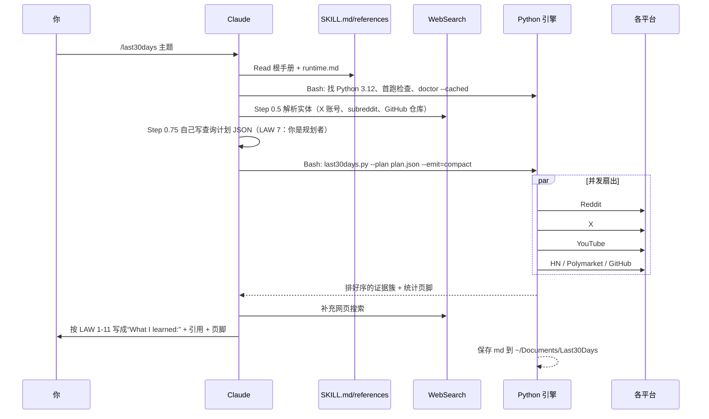
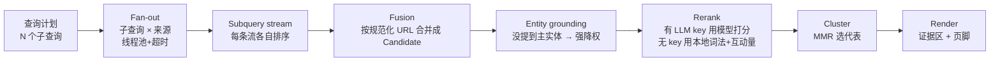
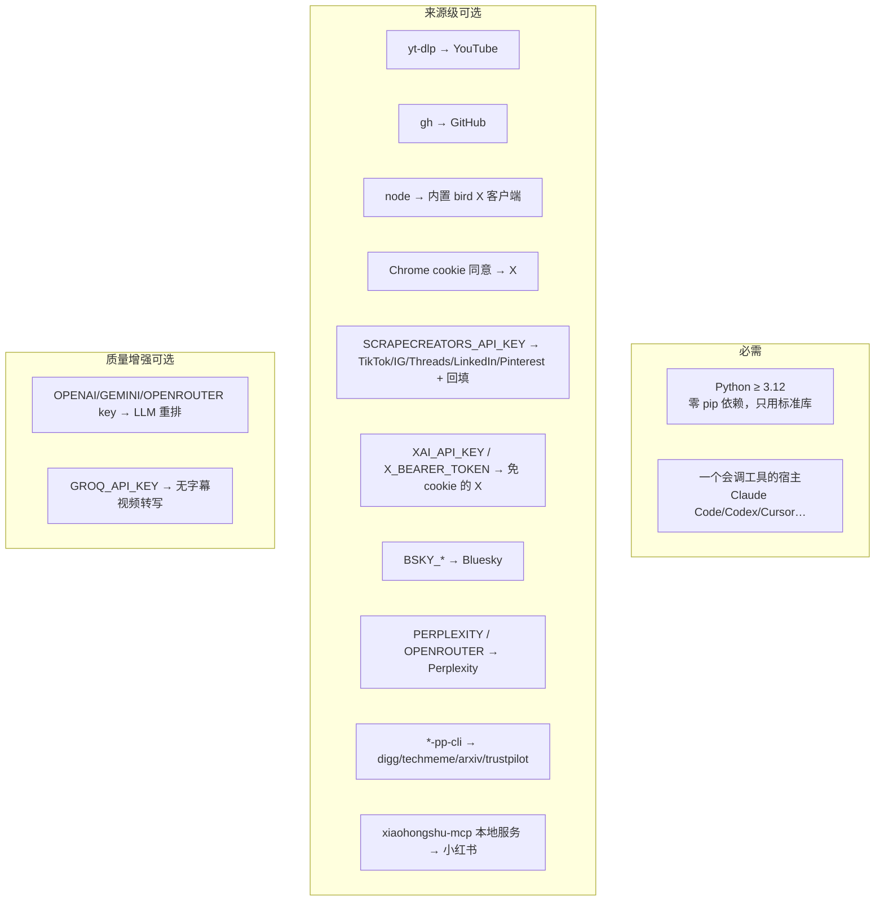

# last30days 原理图解（费曼版）

> 依据：本机安装的 last30days v3.30.0（`~/.claude/plugins/cache/last30days-skill/last30days/3.30.0/`）的 SKILL.md、CONCEPTS.md、mcp/README.md、pyproject.toml，以及 2026-11-01 实际运行的 `doctor` 结果。

## 0. 一句话

last30days = **一本给 Claude 看的操作手册（Skill）** + **一台 Python 抓取排序引擎（Engine）**。
Claude 当主编：定选题、拆搜索词、写稿；引擎当跑腿记者团：同时去 Reddit / X / YouTube / HN / Polymarket / GitHub 抓近 30 天的帖子，按点赞、评论、真金白银的赔率排好序交回来。

## 1. 三层结构：Skill ≠ MCP ≠ Tool

## 2. 一次调研的完整时序

## 3. 引擎内部流水线

## 4. 依赖地图

## 5. 你这台机器现在的状态（2026-11-01 doctor 实测）

| 状态 | 来源 | 说明 |
|---|---|---|
| ● 可用 | Reddit | 公开免 key 抓取；无 ScrapeCreators 回填 |
| ● 可用 | YouTube | yt-dlp 2026.10.21，搜索+字幕+评论 |
| ● 可用 | Hacker News | 免 key |
| ● 可用 | Polymarket | 免 key |
| ● 可用 | GitHub | gh 2.101.0 |
| ● 可用 | Library | 已存 3 份简报，会作为“历史背景”出现 |
| ◐ 已开未验证 | X | bird + Chrome cookie，要跑一次才知道会话是否有效 |
| ○ 可开 | Web | 目前由 Claude 自己的 WebSearch 代劳 |
| ○ 可开 | 小红书 | INCLUDE_SOURCES 已写，但 18060 端口没服务在跑，所以实际不生效 |
| ○ 可开 | TikTok/IG/Threads/LinkedIn/Pinterest/Meta Ads/Telegram | 都卡在 ScrapeCreators key |
| ○ 可开 | Bluesky / Truth Social / Perplexity / digg / techmeme / arxiv / trustpilot / amazon | 各缺 key 或 CLI |

凭据：`.env` 里没有任何 API key，全靠免 key 路径 + 浏览器 cookie。
